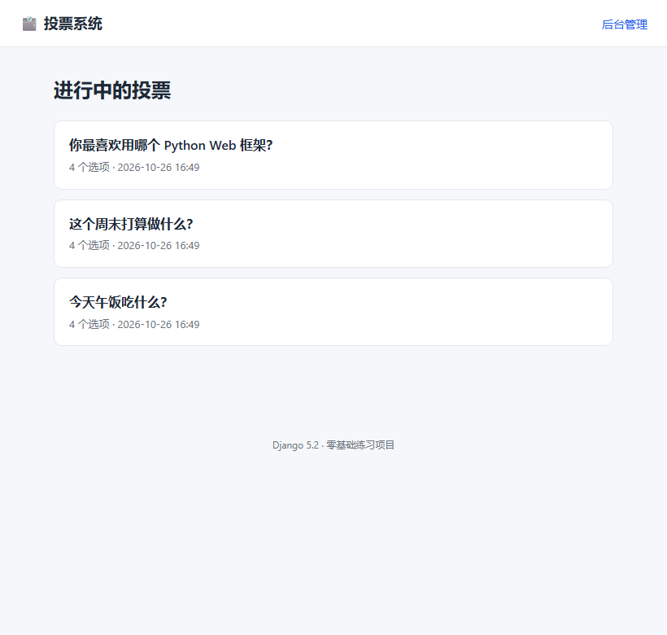
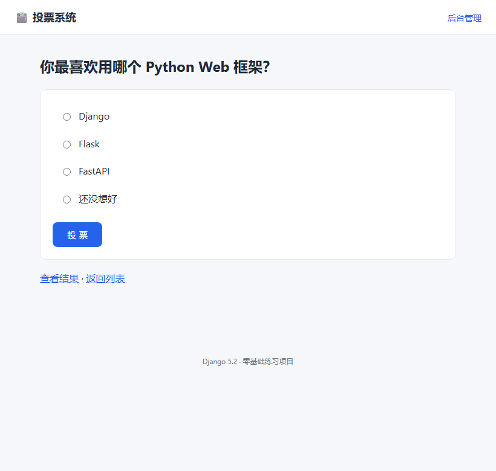
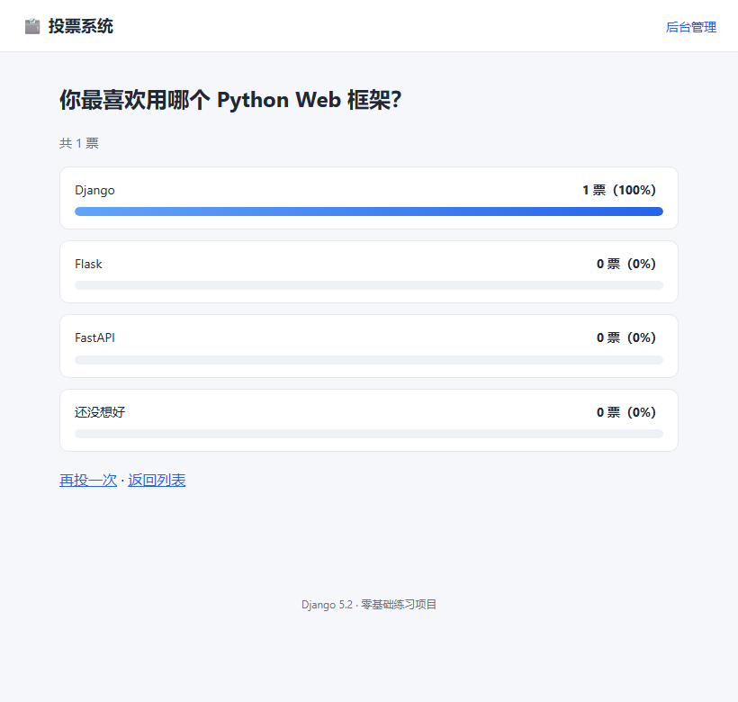

# 目录
- [x] 0. 环境信息
- [x] 1. 怎么运行
- [x] 2. 项目结构
- [x] 3. 这个项目覆盖的 Django 知识点
- [x] 4. 常用命令
- [x] 5. 换台电脑怎么复现
- [x] 6. 本周任务对照

---

# Django 零基础实战 · 投票系统（polls）

> 对应群任务：**搭建 Django 环境 + 熟悉 Django 框架**（2026 年 10 月第 4 周）
> 项目位置：`D:\Code\python\django-learn`

## 效果预览

| 投票列表 | 投票页面 | 结果统计 |
| --- | --- | --- |
|  |  |  |

## 0. 环境信息

| 项目 | 版本 / 说明 |
| --- | --- |
| Python | 3.12.10 |
| Django | **5.2.18 LTS**（长期支持版，课程讲的 Django 5.x 都适用） |
| 依赖管理 | `requirements.txt` + **python-dotenv**（读取 `.env` 里的密钥） |
| 虚拟环境 | `venv\`（已创建，隔离项目依赖，不污染全局 Python） |
| 数据库 | SQLite（Django 默认自带，不用装 MySQL） |
| 编辑器 | VS Code（已配好解释器和 F5 启动） |

## 1. 怎么运行

### 方式 A：VS Code 里按 F5（最简单）

1. VS Code 打开文件夹 `D:\Code\python\django-learn`
2. 按 `F5`，选 **Django: runserver**
3. 浏览器打开 <http://127.0.0.1:8000/polls/>

### 方式 B：终端命令

```powershell
cd D:\Code\python\django-learn
.\venv\Scripts\Activate.ps1      # 激活虚拟环境（提示符前会出现 (venv)）
python manage.py runserver
```

如果报「无法加载文件 …Activate.ps1，因为在此系统上禁止运行脚本」，先执行一次：

```powershell
Set-ExecutionPolicy -Scope Process -ExecutionPolicy RemoteSigned
```

### 页面地址

| 页面 | 地址 |
| --- | --- |
| 投票列表 | <http://127.0.0.1:8000/polls/> |
| 问题详情 / 投票 | <http://127.0.0.1:8000/polls/1/> |
| 投票结果 | <http://127.0.0.1:8000/polls/1/results/> |
| 后台管理 | <http://127.0.0.1:8000/admin/> |

> 后台账号（**仅本地练习用**）：用户 `admin`，密码 `admin123456`
> 停止服务器：终端里按 `Ctrl + C`

## 2. 项目结构

```text
django-learn/
├── manage.py               # 项目管理入口，所有命令都从它开始
├── db.sqlite3              # SQLite 数据库文件（已建好表 + 演示数据）
├── requirements.txt        # 依赖清单（只有 Django）
├── venv/                   # 虚拟环境（不要提交到 Git）
├── mysite/                 # 项目配置包（一个项目可以有多个 app）
│   ├── settings.py         # 全局配置：应用、数据库、语言、时区…
│   ├── urls.py             # 总路由：把 URL 分发给各个 app
│   ├── wsgi.py / asgi.py   # 部署入口（练习阶段用不到）
├── polls/                  # 我们写的应用
│   ├── models.py           # M —— 数据模型（Question / Choice）
│   ├── views.py            # V —— 视图：处理请求、返回响应
│   ├── urls.py             # 应用路由
│   ├── admin.py            # 后台注册
│   ├── tests.py            # 自动化测试（5 个用例，全部通过）
│   ├── migrations/         # 数据库迁移记录，不要手改
│   ├── static/polls/       # 静态文件（CSS）
│   └── management/commands/seed_demo.py   # 自定义命令：插演示数据
├── templates/              # T —— 模板（HTML）
│   ├── base.html           # 母版：头部 / 导航 / 页脚
│   └── polls/              # 各页面模板
└── .vscode/                # VS Code 配置（F5 启动、解释器路径）
```

## 3. 这个项目覆盖的 Django 知识点

| 知识点 | 在哪看 | 一句话说明 |
| --- | --- | --- |
| **MVT 架构** | 整个项目 | Model 数据、View 逻辑、Template 页面，各管各的 |
| **项目 vs 应用** | `mysite/` vs `polls/` | 项目是站点配置，应用是可复用的功能模块 |
| **URL 路由** | `mysite/urls.py`、`polls/urls.py` | `path()` + `include()` + 命名空间 `app_name` |
| **函数视图 FBV** | `views.py` | 一个函数接收 `request`，返回 `response` |
| **模板渲染** | `templates/`、`render()` | `{{ 变量 }}`、``、`` 继承 |
| **模型 & ORM** | `polls/models.py` | 类 = 表，字段 = 列；`objects.filter()` 不用写 SQL |
| **外键关系** | `Choice.question` | `ForeignKey` + `related_name`，一对多 |
| **数据库迁移** | `migrations/` | `makemigrations` 生成、`migrate` 执行 |
| **后台管理** | `admin.py` | 注册模型就得到一整套增删改查页面 |
| **表单处理** | `views.vote`、`detail.html` | POST 提交、`` 防跨站攻击 |
| **重定向** | `views.vote` | `HttpResponseRedirect(reverse(...))`，PRG 模式 |
| **静态文件** | `polls/static/` | `` + `` |
| **自动化测试** | `tests.py` | `python manage.py test` |
| **自定义命令** | `management/commands/` | `python manage.py seed_demo` |

## 4. 常用命令

```powershell
python manage.py check                 # 检查项目配置有没有问题
python manage.py runserver             # 启动开发服务器（默认 8000 端口）
python manage.py runserver 8080        # 换端口（8000 被占用时用）
python manage.py makemigrations        # 模型改了 → 生成迁移文件
python manage.py migrate               # 把迁移应用到数据库
python manage.py createsuperuser       # 创建后台管理员
python manage.py shell                 # 进入交互式 shell，直接操作数据库
python manage.py test                  # 跑全部测试
python manage.py seed_demo             # 本项目自定义：插入演示数据
```

## 5. 换台电脑怎么复现（面试/交作业常问）

```powershell
# 1. 建虚拟环境
python -m venv venv
.\venv\Scripts\Activate.ps1

# 2. 装依赖
pip install -r requirements.txt

# 3. 生成本地配置（必须做，不然启动会报「缺少 DJANGO_SECRET_KEY」）
Copy-Item .env.example .env
python -c "from django.core.management.utils import get_random_secret_key; print(get_random_secret_key())"
# 把上一步输出的字符串填进 .env 的 DJANGO_SECRET_KEY= 后面

# 4. 建表
python manage.py migrate

# 5. 造演示数据 + 管理员
python manage.py seed_demo
python manage.py createsuperuser

# 6. 启动
python manage.py runserver
```

> **为什么要有 `.env`**：`SECRET_KEY` 是 Django 的加密签名密钥，泄露了别人就能伪造登录态。
> 所以它不进 Git（`.gitignore` 里排除了 `.env`），仓库里只放 `.env.example` 这个模板。
> 这是所有真实项目的通行做法，面试问「你怎么管理密钥」就答这个。

## 6. 本周任务对照

- [x] 搭好 Django 环境（Python 3.12 + Django 5.2 + venv）
- [x] 熟悉 Django 框架（MVT、路由、视图、模板、模型、ORM、admin、测试）
- [x] 跑通一个完整的小项目（投票系统，可投票、看结果、进后台）
- [ ] GitHub 账号 id 报给王逸轩（见 `docs/群聊回复与GitHub指引.md`）
- [ ] 过一遍 B 站视频对照（同上文档有观看建议）

## 7. 测试结果

```text
Found 5 test(s).
test_detail_returns_404_for_missing_question ... ok
test_index_lists_only_published_questions ... ok
test_results_page_shows_votes ... ok
test_vote_increments_and_redirects ... ok
test_vote_without_choice_shows_error ... ok

Ran 5 tests in 0.243s
OK
```

> 更细的概念讲解见 [`docs/Django学习笔记.md`](docs/Django学习笔记.md)
